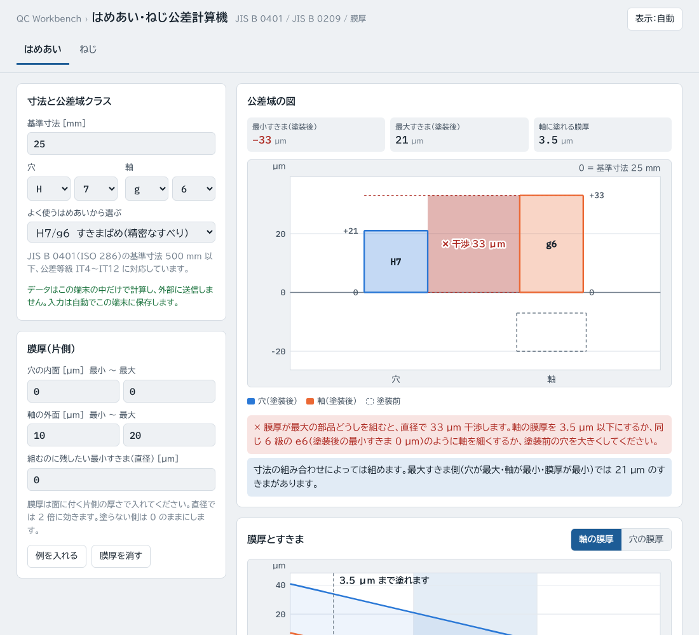
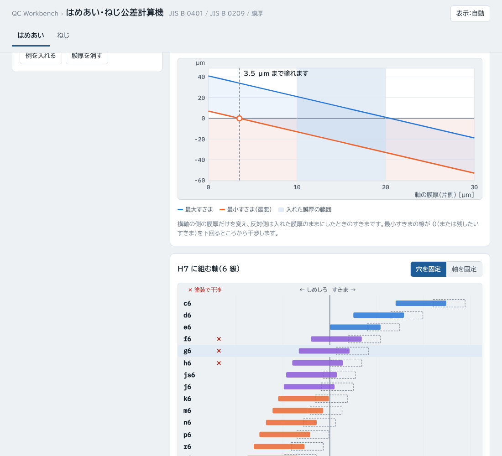
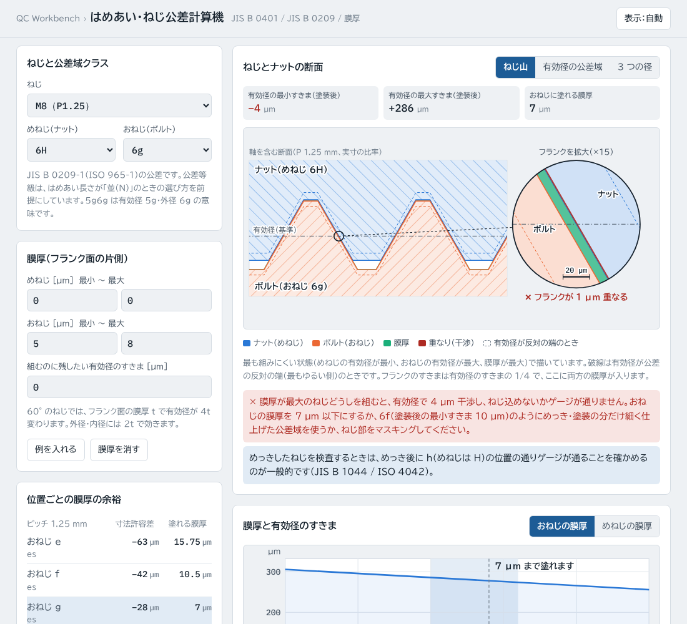

# はめあい・ねじ公差計算機（fit-calc）

はめあい（穴と軸）とメートルねじ（めねじとおねじ）の公差域を図にして、すきま・しめしろを求める Web ツールです。塗装やめっきの膜厚を入れると、組んだときに何 µm 干渉するか、膜厚を何 µm まで入れてよいかを出します。

**https://kotaooka.github.io/fit-calc/**

インストールは不要で、ブラウザで開くだけで使えます。

- **データは外に出ません**。計算はすべてブラウザの中で行い、どこにも送信しません
- 画面の字体（BIZ UDPゴシック・IBM Plex Mono）は Google Fonts から読み込むため、開いたときに Google のサーバーへ接続します。入力した値は送りません
- 入力した値はこの端末のブラウザに自動で保存し、次に開いたときに続きから使えます
- 一度開けば**オフラインでも動きます**。スマートフォンや PC にアプリとして追加することもできます

---

## なぜ膜厚を別に考えるか

図面の公差域クラス（H7/g6、6H/6g など）は、ふつう塗装やめっきの前の寸法です。膜厚は寸法に足されるので、塗装前はすきまばめでも、塗装後に干渉して組めなくなることがあります。

- **平行部**（穴と軸）：膜厚 t は直径に **2t** で効きます
- **ねじ**：60° のねじ山の斜面（フランク）に t 付くと、山は半径方向に t ÷ sin 30° = 2t 太り、有効径は両側で **4t** 変わります。M8 の 6g（es = −28 µm）に H のめねじを組むなら、おねじに塗れる膜厚は 28 ÷ 4 = **7 µm** までです。6h には膜厚の余裕がありません

## はめあい（穴と軸）

### 入れるもの

- **基準寸法** [mm]（0 を超え 500 以下）
- **穴・軸の公差域クラス**：記号（穴 C〜U、軸 c〜u、JS・js を含む）と公差等級（IT4〜IT12）。「よく使うはめあい」からも選べます
- **膜厚**（片側）：穴の内面と軸の外面に、それぞれ最小〜最大の範囲で入れます。塗らない側は 0
- **組むのに残したい最小すきま**（直径）：0 なら「干渉しなければよい」

### 出すもの

- **公差域の図**：穴と軸の公差域を基準線（基準寸法）からの寸法許容差で描きます。塗装後を塗りつぶし、塗装前を破線で描き、重なった（干渉する）部分を帯で示します
- **膜厚とすきまのグラフ**：横軸を片側の膜厚にして、最大すきまと最悪の最小すきまを描きます。最小すきまの線が 0（または残したいすきま）を切るところが、塗れる膜厚の上限です
- **組み合わせ一覧**：穴を固定して軸の記号を変えたとき（または軸を固定して穴を変えたとき）の、塗装後のすきまの範囲を並べます。塗装で干渉するようになる組み合わせに ✕ を付けます。行を押すとその組み合わせに切り替わります
- **結果**：穴・軸の上下の寸法許容差と最大・最小寸法（塗装前・塗装後）、はめあいの種類、最小・最大すきま、最大しめしろ、塗れる膜厚（穴＋軸の合計、軸だけ、穴だけ）と、入れた膜厚が入るかの判定（○ 入る / ✕ 超える）
- 干渉するときは、膜厚の上限と、同じ等級で塗装後も組める軸の公差域クラス（例：g6 → e6）を示します

## ねじ（めねじとおねじ）

### 入れるもの

- **ねじ**：メートル並目 M1.6〜M64 と細目（ISO 261 / JIS B 0205・B 0207 のよく使うもの）。表にないものは呼び径とピッチを入れられます（ISO 965-1 の表にある組み合わせに限ります）
- **公差域クラス**：めねじ 4H〜8H・5G〜8G、おねじ 3h4h〜9g8g（5g6g は有効径 5g・外径 6g）
- **膜厚**（フランク面の片側）：めねじ・おねじそれぞれ最小〜最大
- **組むのに残したい有効径のすきま**

### 出すもの

- **ねじとナットの断面**：軸を含む断面を実寸の比率で描き、ナット（めねじ）とボルト（おねじ）のねじ山、膜厚、重なり（干渉）を示します。最も組みにくい状態（めねじの有効径が最小・おねじの有効径が最大・膜厚が最大）で描き、有効径が反対の端のときの輪郭を破線で重ねます。1 つのフランクを円の中に拡大し、µm 単位のすきま・重なりを目盛つきで見られます
- **公差域の図**（切り替え）：有効径、または外径・有効径・内径の 3 つの公差域を、塗装前と塗装後で描きます
- **膜厚と有効径のすきまのグラフ**、**組み合わせ一覧**（めねじを固定して、おねじの公差域クラスを並べる）
- **位置ごとの膜厚の余裕**：そのピッチで、おねじ e・f・g・h、めねじ G・H に塗れる膜厚の上限
- **結果**：めねじの谷の径 D・有効径 D2・内径 D1、おねじの外径 d・有効径 d2・谷の径 d3 の最大・最小、有効径・外径側・内径側の最小すきま（塗装前・塗装後）、塗れる膜厚と判定

結果は「結果をコピー（Excel 用）」で、入れた値と一緒に Excel に貼り付けられる形でコピーできます。

---

## 計算のしかた

### はめあい

1. JIS B 0401-1・-2（ISO 286-1・-2）の基本公差 IT と、基礎となる寸法許容差の表から、穴と軸の上・下の寸法許容差を出します。穴の K・M・N（8 級以下）と P〜U（7 級以下）は Δ を足します。JS・js は ±IT/2 です
2. 塗装後の寸法許容差：穴は上・下とも 2 × 膜厚だけ下がり、軸は 2 × 膜厚だけ上がります。最小すきまは「穴の膜厚が最大・軸の膜厚が最大」、最大すきまは「両方が最小」の組み合わせです
3. 最小すきま = 穴の下の許容差 − 軸の上の許容差、最大すきま = 穴の上の許容差 − 軸の下の許容差
4. 塗れる膜厚の合計（片側）=（塗装前の最小すきま − 残したいすきま）÷ 2。軸だけに塗れる膜厚は、そこから穴の膜厚の最大を引いた値です

### ねじ

1. 基準寸法：とがり山の高さ H = 0.866025 P、有効径 d2 = d − 0.75 H、内径 D1 = d − 1.25 H、おねじの谷の径 d3 = d − 1.25 H − H/6
2. JIS B 0209-1（ISO 965-1）の表 1〜5 から、基礎となる寸法許容差（es・EI）と公差（TD1・Td・TD2・Td2）を出します
3. 有効径の最小すきま = EI − es、最大すきま =（EI + TD2）−（es − Td2）。塗装後は、めねじ・おねじの膜厚の 4 倍ずつ小さくなります
4. 外径側（おねじの外径の最大とめねじの谷の径の最小）と内径側（めねじの内径の最小とおねじの谷の径の最大）は、膜厚の 2 倍ずつで見ます
5. 塗れる膜厚の合計 =（有効径の最小すきま − 残したいすきま）÷ 4

### 入れていないもの

- 膜厚は面に均一に付くとみなしています。電気めっきは山の頂・端に厚く付き、吹付け塗装は谷やすみにたまりやすいので、分布が分かっているときは厚いところの値を最大に入れてください
- ねじのピッチ誤差・フランク角の誤差による有効径の増え分（ゲージで測る実効有効径）
- はめあい長さ（S・N・L）による公差等級の選び分け。入れた公差域クラスの値をそのまま使います
- 溶融亜鉛めっき用のねじ（JIS B 0209-4・-5 / ISO 965-4・-5）の寸法

## 使うときの注意

- 表の値は JIS B 0401-2（ISO 286-2）と JIS B 0209-1（ISO 965-1）の表から写しています。図面や仕様書に別の値があるときは、そちらを優先してください
- めっきしたねじの合否は、めっき後に h（めねじは H）の位置の通りゲージが通るかで見るのが一般的です（JIS B 1044 / ISO 4042）。このツールの「塗れる膜厚」は、その考え方と同じく、塗装後の有効径が相手の公差域にかからない上限です

---

## 計算の検証

計算は外部ライブラリを使わずに実装し、検算テストを付けています（push のたびに GitHub Actions で実行）。

- ISO 286-2 の表の値との一致（H7・g6・k6・p6・s6・u6・K7・M7・N7・P7・U7 など、3 mm 以下・区分の境目を含む 40 クラス以上）
- 定められていない組み合わせ（24 mm 以下の t、J9 など）を誤りとして返すこと
- H7/g6・H7/k6・H7/p6 のすきま・しめしろとはめあいの種類、膜厚を入れたときのすきまと塗れる膜厚
- ISO 965-2 の 6H・6g の寸法（M3・M5・M6・M8・M10・M10×1.25・M12）との一致
- M8 6H/6g に塗れる膜厚 7 µm、6h では 0、6G/6g の最小すきま、5g6g の公差、表にないねじの扱い

開発者向けの情報は [DEVELOPMENT.md](DEVELOPMENT.md) にあります。

## ライセンス

[MIT License](LICENSE)
